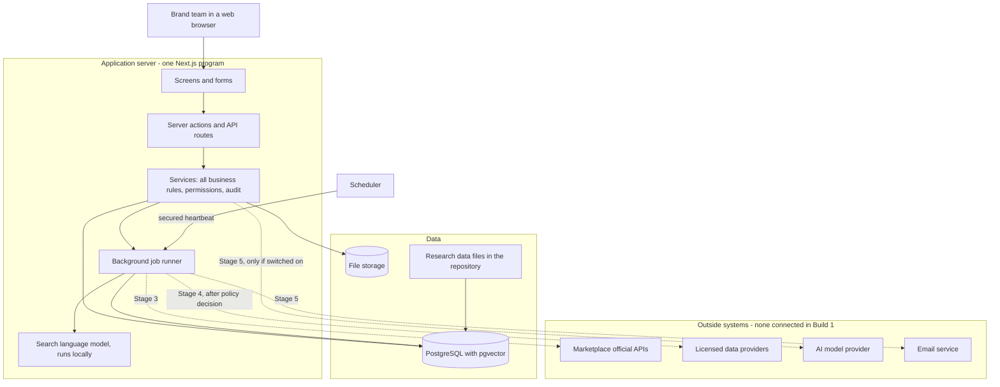
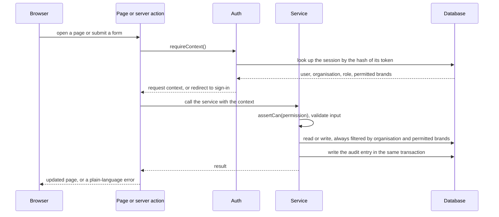
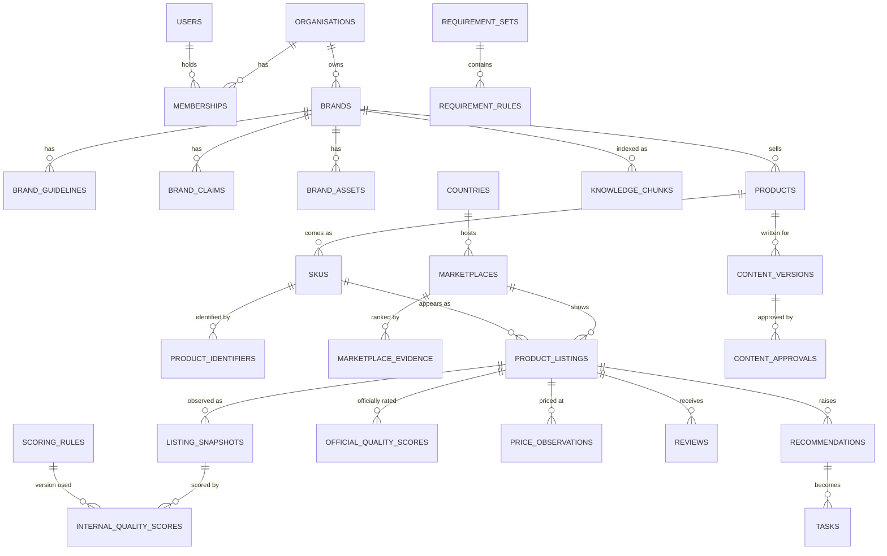
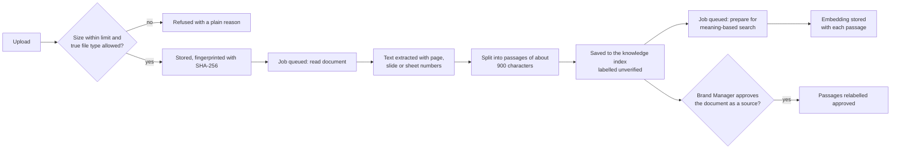
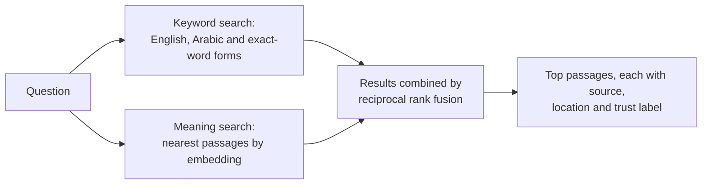
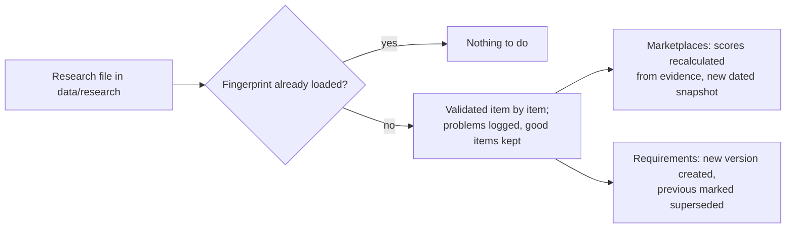
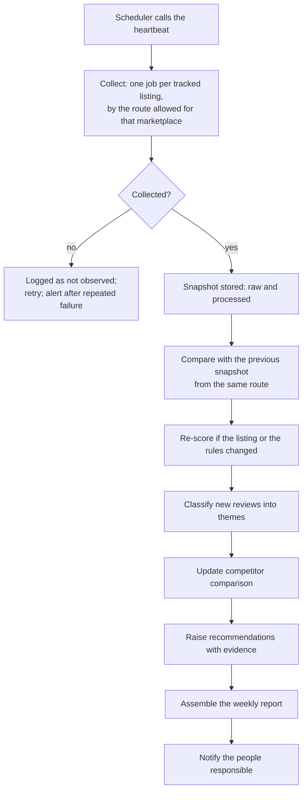
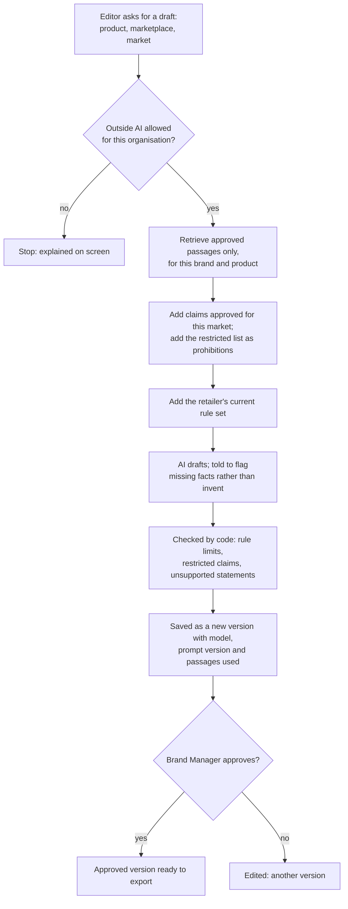
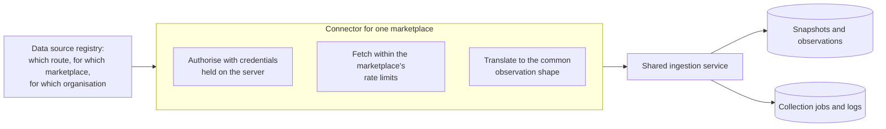
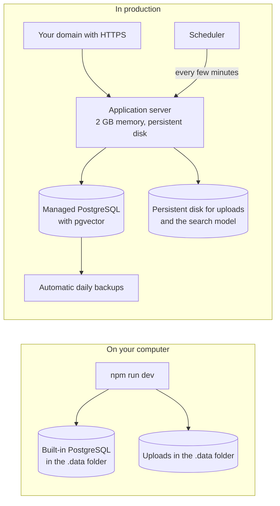

# Deliverable 7 — System Architecture

**How the Brand Intelligence Engine is put together, why each part was chosen, how data moves through it and how outside systems connect**

**Date:** 26 November 2026 · **Describes:** Build 1 as built, and the design for Stages 3–6 · **Companion:** [Database schema reference](database-schema.md) (all 65 tables, column by column)

Parts marked **Built** exist and are tested. Parts marked **Designed** have their database tables in place and a defined place in the code, but no features yet.

---

## 1. The system on one page

Solid lines exist today. Dotted lines are designed and not built.

**In one paragraph.** A single web application serves the screens and contains all the business logic. It stores everything in one PostgreSQL database — ordinary records, the append-only history of observations, the audit log, the background job queue and the search index (keyword and meaning) — and stores uploaded files separately. Slow work runs in a background queue. Outside systems are reached only from the server, never from the browser, and each is optional and switched on deliberately.

---

## 2. The layers, mapped to the specification

| Layer in the specification | What it is here | Where in the code | Status |
|---|---|---|---|
| **A. Brand knowledge base** | Brands, guidelines, claims, products, documents, and one search index over all of them with trust labels | `src/lib/services/{brands,assets,products,knowledge}.ts`, `src/lib/documents/` | Built |
| **E-commerce intelligence** — marketplace map | Researched platforms, evidence, ranking, tracking decisions | `src/lib/services/marketplaces.ts`, `data/research/marketplaces/` | Built |
| — requirements engine | Versioned rule sets and official quality signals per retailer | `src/lib/services/reference.ts`, `data/research/requirements/` | Library built; rule checking Designed (Stage 4) |
| — SKU mapping, digital shelf | Listings, snapshots, prices, availability, images | `src/db/schema/shelf.ts` | Designed (Stage 3) |
| — scoring, reviews, competitors | Official and internal scores, themes, comparisons | `src/db/schema/{shelf,intelligence}.ts` | Designed (Stage 4) |
| **AI content engine** | Retrieval from approved knowledge, generation, validation, approval | `content_versions`, `content_approvals` tables | Designed (Stage 5) |
| **Data collection and automation** | Job queue, scheduler heartbeat, data-source registry, collection runs | `src/lib/jobs.ts`, `src/app/api/jobs/tick/`, `src/db/schema/automation.ts` | Queue and heartbeat Built; collection Designed (Stage 3) |
| **Dashboard** | Thirteen navigation areas; planned ones state honestly that they are planned | `src/app/(app)/` | Built for live modules |
| **Control centre** | Roles, brand-level access, approvals, audit log | `src/lib/auth/`, `src/lib/services/{team,audit}.ts` | Built |

---

## 3. Technology choices and the reason for each

The specification asked that the stack be evaluated, not assumed, and that nothing be forced into one technology for convenience. Every choice below was tried in a small working experiment before being adopted.

| Part | Choice | Why | What was considered instead | When to revisit |
|---|---|---|---|---|
| Language | **TypeScript** everywhere | One language for screens, rules and database means one set of types from the database to the form: a renamed column fails the build instead of failing in front of a user. It also means one program to deploy and one skill set to hire | Python with FastAPI for the back end. Better for data science; costs a second service, a second deployment and a hand-maintained contract between the two | When heavy statistical or machine-learning work appears. A Python worker can then be added beside the application — the job queue is the seam (section 9) |
| Web framework | **Next.js 16** with React 19 | Screens and server logic in one project; server-rendered pages keep data access on the server; form submissions call server code directly without a hand-written API | A separate single-page front end with its own API — more moving parts for the same result | — |
| Database | **PostgreSQL** | Relational data, append-only history, text search and vector search in one engine with real transactions. One system to back up and secure | A separate vector database or search engine — more to run, and the data would be split | If keyword search needs outgrow PostgreSQL's (unlikely at this scale) |
| Meaning-based search | **pgvector** inside PostgreSQL | Search results respect the same organisation and brand access rules as every other query, because they are the same query | A hosted vector service | If passages reach millions |
| Development database | **PGlite** — PostgreSQL compiled to run inside the application | `npm run dev` works with nothing to install. It is real PostgreSQL (version 19), so behaviour matches production; the test suite runs on both | SQLite — different SQL dialect and no pgvector; Docker — one more thing for a non-developer to install | Never used for production: the application warns and the guide says so |
| Database access | **Drizzle ORM** | The schema is ordinary TypeScript; migrations are plain SQL files that can be read and reviewed; queries are type-checked | Prisma — a heavier runtime and less direct control over SQL | — |
| Sign-in | **Built in**: passwords hashed with scrypt, sessions stored in the database, invitation links | No third-party identity service to configure or pay for; works identically on a laptop and in production; small and fully tested | Supabase Auth, Auth.js, a hosted identity provider. Each ties the product to a vendor or adds configuration before first run | Stage 6: add single sign-on and two-step verification. The session layer is isolated in `src/lib/auth/` for that purpose |
| Background work | **A job queue in PostgreSQL** | No extra infrastructure; jobs are transactional with the data they act on; retries, back-off and crash recovery are built in | Redis with a queue library — another service to run; n8n as the engine — good for visual workflows, but business rules would live outside the tested code | n8n remains a good *scheduler and notifier* in front of the heartbeat address (section 8) |
| Embeddings | **A small open multilingual model run on the server** (`multilingual-e5-small`, 384 dimensions) | Brand documents never leave the server; no per-use cost; handles English and Arabic | An embeddings API — better quality at a price, and it sends document text outside | If search quality proves insufficient. The provider is one small interface (`src/lib/embeddings.ts`) and can be swapped with a re-index |
| Document reading | **unpdf** for PDF; direct reading of Word, PowerPoint and Excel files | Pure JavaScript, no system packages; passages keep their page, slide or sheet number for citation | Python document tools (Docling, MarkItDown) — stronger on complex layouts and scanned pages, but need a Python service ([Deliverable 5](../research/05-github-skills-inventory.md)) | Stage 4, when text recognition for scanned documents is added |
| Images | **sharp** | Fast, standard; measures and validates images | — | — |
| Styling | **Tailwind CSS 4** with the product's own small set of components | A distinctive, consistent interface without a large dependency; about a dozen components cover every screen | A ready-made component library — quicker to start, harder to make look like anything but itself | When charts arrive in Stage 4, add one charting library chosen for accessibility |
| File storage | **Server disk behind a five-method interface** | Simplest thing that works for one server | Cloud object storage from day one | **Stage 6:** an S3-compatible driver (Supabase Storage, Cloudflare R2, Amazon S3). Required before running on more than one server or on a serverless host |
| AI provider | **Not chosen in Build 1.** Designed as an interface with a per-organisation switch that is off by default | The specification forbids sending brand documents to outside AI without approval. Cost comparison in [Deliverable 8](../product/08-build-vs-buy.md#32-running-cost-recurring) | — | Your decision before Stage 5 |

**Versions in use:** Next.js 16.4.6, React 19.3.1, TypeScript 5, Tailwind CSS 4.3.3, Drizzle ORM 0.45.4, PGlite 0.6.0, zod 4.6.7, vitest 5.1.2, Playwright 1.63.0. Exact versions are pinned in `package.json`. Licences of the open-source components evaluated are in [Deliverable 5](../research/05-github-skills-inventory.md).

---

## 4. How a request is handled

Every screen and every action follows the same four steps. This sameness is deliberate: it is what makes the permission and tenancy rules checkable.

| Rule | Where it is enforced |
|---|---|
| Is this person signed in? | `requireContext()` at the top of every page and action (`src/lib/auth/server.ts`). The request proxy (`src/proxy.ts`) also turns away visitors with no session cookie early, as a convenience only |
| May this role do this? | `assertCan(ctx, permission)` as the first line of every service function |
| Does this belong to their organisation and to a brand they may see? | Every query filters by `organisation_id`; brand-restricted users are filtered by their permitted brand list |
| Was it recorded? | `audit(ctx, event, tx)` inside the same database transaction as the change |
| Is the input valid? | zod schemas in each service; errors come back as field-level messages |

The interface hides buttons a role cannot use, but that is never the protection: the browser test "the Viewer can read but not change anything — in the interface and on the server" calls the server directly and confirms it refuses.

---

## 5. The data model

Sixty-five tables in seven groups. The full column-by-column reference is generated from the code: [database-schema.md](database-schema.md).

| Group | Tables | In use today |
|---|---|---|
| Identity and access | organisations, users, roles, memberships, membership_brand_access, invitations, password_resets, sessions, login_attempts, audit_logs | Yes |
| Brand knowledge base | brands, brand_guidelines, brand_claims, brand_assets, knowledge_chunks, competitors, brand_competitors, brand_books | Yes |
| Product catalogue | products, product_variants, skus, product_identifiers, product_attributes, product_media, product_market_availability | Yes |
| Markets, marketplaces and requirements | countries, research_imports, country_research, marketplaces, marketplace_evidence, marketplace_sources, marketplace_research_snapshots, marketplace_settings, brand_marketplace_presence, marketplace_categories, requirement_sets, requirement_rules, marketplace_quality_signals | Yes |
| Digital shelf observations (competitor products, marketplace products, listings and prices are used by Pricing Intelligence today) | data_sources, competitor_products, marketplace_products, sku_marketplace_matches, product_listings, listing_snapshots, listing_images, price_observations, availability_observations, rating_observations, reviews, review_themes, review_theme_assignments, customer_questions, customer_answers | Stage 3–4 (review themes are seeded) |
| Scoring, content and actions | scoring_rules, internal_quality_scores, official_quality_scores, content_versions, content_approvals, recommendations, tasks | Stage 4–5 (scoring rules are seeded) |
| Automation and reporting | background_jobs, automation_workflows, collection_jobs, collection_logs, reports | background_jobs today; the rest in Stages 3–5 |

**Every entity the specification listed has a table.** Where one specification entity became two tables, it is because they hold different things: *Product Images* is `product_media` (your own approved images) and `listing_images` (what was observed on a retailer); *Marketplace Requirements* is `requirement_sets` (a version) and `requirement_rules` (its rules); *Markets* and *Countries* are one table, with a region on each country.

### The design rules that protect data integrity

| Rule | How the database enforces it |
|---|---|
| History is never overwritten | Observation tables are append-only: a new observation is a new row with its own time. Research and requirement sets are versioned |
| Every observation says where it came from | Columns on every observation table: data source, collection method, collection time, confidence, the raw observation and the processed result — stored separately |
| Missing is not zero | Observations carry an explicit outcome. "Not observed" and "unavailable" are different values; a figure that was not obtained is stored as *null* with a reason, never as 0 |
| Scores are reproducible | A score row points at the exact snapshot and scoring-rule version, and stores a fingerprint of its inputs |
| Official scores are never fabricated | `official_quality_scores` has no default and no calculation path; rows are written only by a connector that obtained the score |
| The audit log cannot be changed | A database trigger rejects every direct UPDATE or DELETE on `audit_logs` — even from an administrator's database console |
| No reviewer identities | The `reviews` table has no name, profile or photo column; only a one-way fingerprint for detecting duplicates |
| No secrets in the database | `data_sources.configuration` holds non-secret settings only |
| Bad values are rejected | CHECK constraints on status and class columns; foreign keys between all modules |

---

## 6. Data flows

### 6.1 A document becomes searchable knowledge — Built

Points worth knowing:

- **The file type is decided by the file's contents, not its name.** A program renamed to `.pdf` is refused (browser test "a file that is not what it claims to be is refused").
- **Compressed documents are size-checked while being opened**, which protects against files built to exhaust memory.
- **The upload returns immediately**; reading happens afterwards, survives a restart and retries on failure.
- **Scanned PDFs yield no text today.** The product says so on the document; text recognition is Stage 4.

### 6.2 A search — Built

Both searches run inside PostgreSQL and both apply the organisation and brand filters, so nobody can find a passage they are not allowed to open. A passage found only by meaning must clear a similarity threshold, which stops loosely related text from appearing as an answer. If the language model is still loading, keyword search answers on its own and the screen says which methods were used.

### 6.3 Research becomes reference data — Built

The priority score and rank are **always recalculated on loading** from the per-criterion scores and the fixed weights — a total written in a file is never trusted. This is the same reproducibility rule the listing score will follow.

### 6.4 The weekly cycle — Designed (Stages 3–5)

### 6.5 Writing content — Designed (Stage 5)

The check after generation is ordinary code, not a second opinion from the AI: a title over the retailer's limit or a restricted phrase is caught by rule.

---

## 7. Integration strategy

### 7.1 Principles

1. **Order of preference**, fixed by the specification: official marketplace API → authorised data provider → approved retailer integration → permitted public collection → manual upload.
2. **Every connector writes through the same door.** A connector produces observations; a shared service validates them, stores raw and processed forms, records the route and detects changes. Connectors contain no business rules.
3. **Spreadsheet import is a connector too** — and is built first in Stage 3, so every marketplace is usable before any API is approved.
4. **Routes never mix.** Each observation records its collection method, so data from different routes is compared only with itself, and a route can be switched off without losing history.
5. **No connector bypasses a login, a CAPTCHA or a block**, and none collects reviewer identities.
6. **Nothing is called working until it has run against the real service** with a real account.

### 7.2 What a connector is

Each connector implements four operations: *check the connection*, *list own listings*, *fetch a listing*, and — where the marketplace offers one — *fetch the official quality signal*. Credentials are read from server configuration or a secrets manager; the database holds only the non-secret settings.

### 7.3 Plan by platform

From the research in [Deliverable 4](../research/04-api-data-feasibility.md). "Own listings" means the account that sells the product must authorise the connection.

| Platform | Own-listing route | Official quality signal | Stage |
|---|---|---|---|
| Any platform | Spreadsheet import | Entered by hand, flagged as manual | 3 |
| Amazon (US, UK, UAE, Saudi Arabia, India, South Africa) | Selling Partner API | Listing issues by API; the quality indicator is on-screen only | 3 |
| Noon (UAE, Saudi Arabia) | Partner Content, Pricing, Offer and Stock APIs | Completeness and quality-check status | 3 |
| Walmart (US) | Marketplace API | Listing Quality score, 0–100 | 3–4 |
| Takealot (South Africa) | Seller API | Listing quality field | 3–4 |
| Shopee, Lazada, TikTok Shop (Malaysia and others) | Open platform APIs | Level, Content Score, tier | 3–4 |
| Flipkart (India) | Seller API | None documented | 4 |
| Jumia (Kenya, Nigeria) | Portal exports; API reported but unconfirmed | Quality-check status | 3 by upload |
| Boots, Tesco, Nykaa, Nahdi, Clicks, Life Pharmacy and other retailers | No public API — files from the retailer or distributor | None found | 3 by upload |
| Competitor listings anywhere | Licensed data provider | Not applicable | 4, after the policy decision |

### 7.4 Other integrations

| Integration | Design | Stage |
|---|---|---|
| **AI model** | One interface with three operations — draft, assess, classify — behind the organisation's switch. Every call records model, prompt version, inputs used and token counts. Structured output is validated against a schema before use | 5 |
| **Scheduler** | Anything that can make a timed web request: the hosting platform's cron, or n8n. It calls `POST /api/jobs/tick` with a secret. n8n is the recommended choice if you also want visual workflows and notifications to chat tools | Heartbeat built; schedules in 3–5 |
| **Email** | A transactional email service for invitations and the weekly report | 5 |
| **Barcode ownership** | "Verified by GS1" look-ups, where a local GS1 office offers API access | 4, optional |
| **Google Merchant Center** | Market benchmarks through the Merchant API | 4, optional |

---

## 8. Background work and scheduling

Built today:

- **The queue is a database table.** A worker claims the next job with a lock that other workers skip, so several workers can run safely side by side.
- **Failures retry with increasing delay** up to a limit, then stay visible as failed with the error.
- **A job left running by a crashed server is returned to the queue** after fifteen minutes.
- **Two triggers.** Work starts immediately after the action that created it, and the heartbeat address sweeps up retries and anything scheduled. The heartbeat also clears expired sessions.
- **The heartbeat is protected** by a long random secret compared in constant time, and answers "not configured" if no secret is set.

Job types today: *read an uploaded document* and *prepare passages for meaning-based search*. Stages 3–5 add collection, change detection, scoring, review classification and report generation as further job types — same queue, same retry rules.

---

## 9. Where a second technology would be the right call

The specification warns against forcing everything into one technology. These are the seams where something else can be added without rewriting:

| If this is needed | Add | It plugs in at |
|---|---|---|
| Heavy document understanding (complex layouts, scanned pages at volume) | A Python service using an open-source document parser | A job type; the result is written to the same knowledge index |
| Statistical forecasting or custom machine-learning | A Python worker | The job queue: the worker claims jobs of its own type from the same table |
| Visual, user-editable workflows and chat notifications | n8n | The heartbeat address and, later, a small set of read-only API routes |
| Large-scale collection | A dedicated worker process, separate from the web server | The same queue |
| More than one server, or a serverless host | S3-compatible object storage | The storage interface |

---

## 10. Security architecture

The plain-language version, with what you need to do as the owner, is the [security guide](../guides/security.md).

| Concern | Built in Build 1 | Planned |
|---|---|---|
| **Passwords** | scrypt with a per-password salt and a high work factor; minimum length enforced; never logged. People change their own password; a forgotten one is recovered by a one-time, 24-hour link from an Administrator or the server command line, which signs the person out everywhere | Two-step verification, single sign-on (Stage 6) |
| **Sessions** | 32 random bytes; only a hash is stored, so a database leak does not expose sessions; 14-day life extended on use; cookie is HttpOnly, SameSite=Lax and Secure in production; sign-out and account disabling end sessions | — |
| **Password guessing** | Attempts counted per email address and per network address in a 15-minute window, then refused | Rate limits on all routes at the hosting edge (Stage 6) |
| **Permissions** | Six roles; one matrix; checked in every service function | — |
| **Tenant isolation** | Every query scoped by organisation and permitted brands; covered by tests that try to cross the boundary | **Row Level Security** in the database as a second line of defence (Stage 6) — see below |
| **Audit** | Every change recorded with who, when and what, in the same transaction; tamper-proof by database trigger | Export and retention policy (Stage 6) |
| **Uploads** | Size limit; type verified from content; allow-list; stored outside the web root under generated names; downloads require sign-in and brand access, and are served with content-type sniffing disabled | Malware scanning (Stage 6) |
| **Cross-site attacks** | Same-origin checks on state-changing requests; strict response headers (no framing, no MIME sniffing, restricted sources) | A stricter script policy with per-request nonces (Stage 6) |
| **Secrets** | Only in server environment variables; none in the browser bundle, the database or the repository; `.env*` files are git-ignored | Encrypted credential storage for marketplace connectors (Stage 3) |
| **Outside AI** | Off by default per organisation; changing it is audited; no provider is wired in | Provider data-handling review before switching on (your decision) |
| **Collectors** | None exist yet | Outbound allow-list per connector; per-source rate limits (Stage 3) |
| **Personal data** | Team members' names and emails only. No shopper data. Reviewer identities are never stored by design | Data-protection review with counsel before review collection (Stage 4) |

**Row Level Security — honest status.** The specification asks for it "where supported". It is supported by PostgreSQL and is **not switched on in Build 1**. Tenancy today is enforced by the service layer, uniformly, and tested. Row Level Security adds protection against a future coding mistake by making the database itself refuse rows from another organisation. It is scheduled for Stage 6 because it must be designed together with the production hosting choice (it works through a database setting applied per request, and its behaviour with connection pooling needs testing on the chosen host). Until then, do not give anyone direct database access who should not see every organisation's data.

**Dependency check.** `npm audit` reports four moderate-severity findings, all in a development-only tool (the database migration generator's bundler). Nothing affected runs in production.

---

## 11. Deployment architecture

| | Managed hosting | Self-hosting |
|---|---|---|
| What it means | A platform runs the server and the database for you | You rent a virtual server and run both yourself |
| Monthly cost | ESTIMATE $50–$90 ([Deliverable 8](../product/08-build-vs-buy.md#32-running-cost-recurring)) | Lower in fees; higher in time |
| Backups, updates, HTTPS | Handled by the platform | Yours to set up and test |
| Skills needed | Following a step-by-step guide | A system administrator |
| Recommendation | **Start here** | Only with in-house operations skills, or if data must stay in a particular country and no managed region fits |

Step-by-step instructions, and a clear list of what has and has not been tested, are in the [deployment guide](../guides/deployment.md).

**Constraints of Build 1 to know before choosing a host:** it needs a long-running server with a persistent disk (so not a serverless platform yet), and it should run as a single instance until file storage moves to object storage in Stage 6.

---

## 12. Quality and testing

| Layer | What it checks | Count |
|---|---|---|
| Unit tests | Barcode validation, permission matrix, priority formula, document reading and splitting | 29 |
| Integration tests | Services against a real PostgreSQL engine: sign-in, sessions and password recovery, brands and products, import, knowledge search, research loading and versioning, the audit trigger, pricing and brand books | 80 |
| Browser tests | A full user journey on a production build, including refused actions for a Viewer, cross-site refusal, file-type refusal, password recovery, pricing and brand books | 23 |
| Static checks | TypeScript type-check and lint | — |

All 80 integration tests were also run against a real PostgreSQL 16 server with pgvector 0.6.0, not only the built-in engine. Nothing is described as working unless `npm run typecheck && npm run lint && npm test && npm run test:e2e` all pass.

---

## 13. Known limitations of Build 1

Stated plainly so that nothing is discovered later as a surprise.

1. **No marketplace data is collected.** No API or provider is connected.
2. **No AI provider is connected.** Meaning-based search is the only machine-learning feature and it runs locally.
3. **Row Level Security is not enabled** (section 10).
4. **Files are on the server's disk**, so one server only, and not a serverless host.
5. **Scanned documents are not read**; images are measured, not interpreted.
6. **No single sign-on or two-step verification.**
7. **No password-reset email.** A forgotten password is recovered with a one-time link that an Administrator creates and passes on, or from the server command line. Self-service reset by email arrives with the email service in Stage 5.
8. **Meaning-based search uses exact comparison** — right for tens of thousands of passages; an approximate index is one migration away.
9. **The interface is English only**, though content and search handle Arabic.
10. **Not yet deployed to any hosting provider.** It has been run as a production build locally and against a local PostgreSQL server.
11. **Requirement rules are maintained as data files**, not edited in the product.

---

## 14. How to extend it

**Add a module** (for example Social Intelligence in Phase 3): add tables in a new `src/db/schema/` file and generate a migration; add a service that takes the request context and follows the four steps in section 4; add pages under `src/app/(app)/`; add a navigation entry and permissions. The knowledge base, approvals, audit log and job queue are reused as they are.

**Add a marketplace connector:** implement the four connector operations; register the data source; map its fields to the common observation shape; test it against the real service before describing it as working.

**Add a background job:** write a handler, register it in `src/lib/job-handlers.ts`, and enqueue it from a service.

**Change the database:** edit `src/db/schema/`, run `npm run db:generate`, review the SQL it writes, commit it. Then run `npm run docs:generate` to refresh the schema reference.

The working conventions for AI coding tools are in `CLAUDE.md` at the top of the repository.
