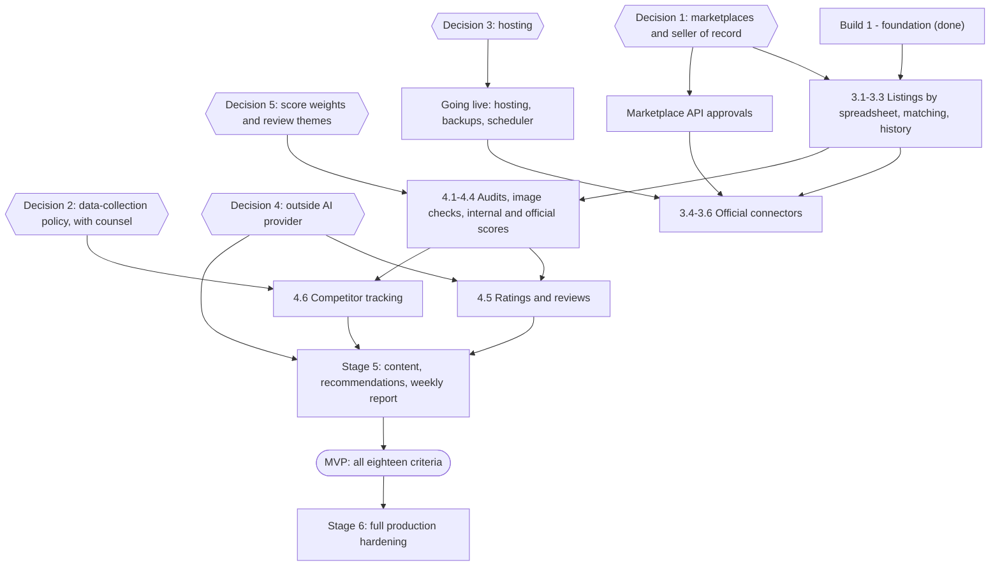

# Deliverable 9 — Development Roadmap

**A realistic, phased plan from the working foundation to the complete Phase 1 product**

**Date:** 26 November 2026 · **Related:** [Product requirements](06-product-requirements.md) · [Architecture](../architecture/07-system-architecture.md) · [Build-versus-buy and costs](08-build-vs-buy.md)

> **About the estimates.** Effort is given in *person-weeks* for one experienced full-stack developer and is labelled ESTIMATE. It is a planning range, not a promise. Calendar time depends less on writing code than on three things outside the code: your decisions, marketplace approvals, and testing against real accounts. No calendar dates are given for that reason.

---

## Where things stand

| Stage | Content | Status |
|---|---|---|
| 1 | Research and specification | **Done** — the ten deliverables |
| 2 | Working foundation: sign-in and roles, dashboard, brands, product catalogue, file upload, knowledge base, database | **Done and tested** |
| 3 | E-commerce intelligence | **Partly done** — marketplace mapping and the requirements library are built; listing monitoring is next |
| 4 | Intelligence and scoring | Not started — tables exist |
| 5 | AI and automation | Not started — tables, job queue and scheduler heartbeat exist |
| 6 | Production readiness | Not started — the essentials are pulled forward (see "Going live") |

**Against the eighteen MVP criteria:** seven are met, three are partly met and eight need Stages 3–5. The criterion-by-criterion table is in the [product requirements](06-product-requirements.md#5-the-mvp-and-its-acceptance-criteria). The MVP is complete at the end of Stage 5.

---

## How the pieces depend on each other

The important reading of this picture: **the first three steps of Stage 3 need nothing but Decision 1**, so work can continue immediately while approvals, hosting and legal review proceed in parallel.

---

## Decisions needed from you

Each decision says what it blocks, the options, and a suggestion. None needs technical knowledge.

### Decision 1 — Which marketplaces first, and who sells there

**Blocks:** all of Stage 3.

For each marketplace you want to track, two answers: do we track it, and **who is the seller of record** — your own seller account, the retailer buying from you, or a distributor. The second answer decides which data routes exist: official APIs answer only to the account that sells the product ([Deliverable 4, section 4](../research/04-api-data-feasibility.md#4-what-a-brand-that-sells-through-distributors-can-and-cannot-get)).

**Suggestion:** start with the top three platforms in your two or three most important countries rather than all nine at once. **Where to record it:** in the product, open *Marketplace Intelligence*, choose a platform, and fill in "Your decision" and "Are our brands sold here?" — it takes a minute per platform.

### Decision 2 — The data-collection policy for competitor data

**Blocks:** competitor tracking (step 4.6) only.

Official APIs give almost nothing about competitors. Licensed data providers do, but marketplace terms prohibit automated collection and most providers get past anti-bot systems on the customer's behalf — which sits uneasily with your rule against bypassing technical restrictions. The three options (A: official sources only · B: a provider for public product facts on a defined list · C: broad) are set out in [Deliverable 4, section 6](../research/04-api-data-feasibility.md#the-policy-decision).

**Suggestion:** Option B as a starting point, **subject to your legal counsel's review**. This is a decision for you and counsel, not for a developer.

### Decision 3 — Where to host

**Blocks:** scheduled collection, real credentials, and use by the wider team.

**Suggestion:** managed hosting — an application host with a persistent disk plus a managed PostgreSQL database with pgvector; ESTIMATE $50–$90 a month ([costs](08-build-vs-buy.md#32-running-cost-recurring)). If company policy requires data to stay in a particular country, say so before choosing: it narrows the options. Steps are in the [deployment guide](../guides/deployment.md).

### Decision 4 — Whether an outside AI provider may process brand content, and which

**Blocks:** Stage 5, and the AI-assessed parts of Stage 4 (review themes, image interpretation).

Content generation means sending brand knowledge to an AI provider. The product keeps this switched off until an Administrator turns it on. Before doing so, have whoever handles data protection in your company review the provider's commercial terms: whether your data is used for training, how long it is kept, and where it is processed.

**Suggestion:** approve one provider for a pilot on one brand. Model options and costs are in [Deliverable 8](08-build-vs-buy.md#32-running-cost-recurring).

### Decision 5 — Do the proposed score weights and review themes suit your categories

**Blocks:** nothing — defaults exist — but your review makes the scores yours.

The proposed listing-quality weights and the starting list of review themes for beauty and personal care are shown in the product under *Listing Quality* and *Reviews & Ratings*. Both are versioned, so they can be changed later without losing history.

### Decision 6 — Who maintains the product

**Blocks:** nothing now; matters from the day real data flows.

Options: continue with AI coding tools under your direction, as Build 1 was made; a developer or agency on a small retainer; or an in-house developer. ESTIMATE of the work: 2–4 days a month once everything is live ([maintenance](08-build-vs-buy.md#34-maintenance)).

---

## Things to start now — they have lead times and need no development

| Action | Why now | Who |
|---|---|---|
| Put your real brand into Build 1: brand profile, brand book, claims, product catalogue with barcodes | Every later stage reads from this. Missing barcodes are the commonest cause of unmatched listings | Brand team |
| Record tracked marketplaces and seller of record (Decision 1) | Unblocks Stage 3 | You |
| Enrol in Amazon Brand Registry with the *Brand Representative* role, where not already done | Unlocks search reports and content alerts; the *Reseller* role does not | Whoever holds the trade mark |
| Ask the owner of each selling account to register for API access (Amazon Selling Partner API; Noon partner APIs; others where you sell) | Approvals take time. How long was not verified — allow several weeks | Seller-account owner |
| Ask distributors what data they can share, and add data-sharing duties at the next contract review | Where a distributor is the seller, this is the only official route | Commercial team |
| Brief legal counsel on Decision 2, with Deliverable 4 section 6 | Counsel needs time | You |
| Optional: ask for two vendor demonstrations and put the five questions in [Deliverable 2, section 8](../research/02-competitor-capability-matrix.md#8-questions-to-put-to-any-vendor-before-buying) | Tests the coverage finding at no cost | You |

---

## Stage 3 — E-commerce intelligence

**Goal:** see how every product actually appears on every tracked marketplace, with history.
**ESTIMATE:** 4–7 person-weeks. **Completes MVP criteria:** 7 and 8.

Each step is one self-contained build with its own tests, delivered and usable before the next begins.

| Step | What is built | You will be able to | Waits on |
|---|---|---|---|
| **3.1 Listings by spreadsheet** | A listing template per marketplace; import with a check-first step; each import creates listings and a dated snapshot marked "manual upload" | Load real listing data for any marketplace the same day, from a seller-portal export or a distributor's file | Decision 1 |
| **3.2 SKU-to-listing matching** | Automatic proposals by barcode, then by code, name, size and pack, each with a confidence score and reasons; a review queue; manual match, approve, reject; competitor products added and linked to competitor brands | Confirm which listing is which product; see unmatched SKUs and unrecognised listings | 3.1 |
| **3.3 History and change detection** | Snapshot comparison for title, bullets, description, images, price, promotion and availability; a change feed per product and per marketplace; "not observed" kept apart from "unavailable"; the Digital Shelf screens | Open any product and see how it looks now, how it looked before and what changed | 3.2 |
| **3.4 Connector framework** | Data-source registry screen; credentials held securely on the server; per-source rate limits and outbound allow-list; collection runs with logs; schedule per marketplace | See every data source, its last run and its failures in one place | Going live |
| **3.5 First official connector** | Whichever account is approved first — Amazon Selling Partner API or Noon — for own-listing content, price, stock and issues. **Tested against your real account before it is described as working** | Receive listing data automatically | API approval |
| **3.6 Second connector and weekly schedule** | The other of Amazon and Noon; a scheduled weekly collection | Stop exporting files by hand for those marketplaces | API approval |

**Finished when:** every tracked listing has a dated snapshot from a recorded route; a changed title, price or image shows up as a change; a failed collection shows as "not observed"; and at least one official connector has run successfully against a real account.

## Going live — the production essentials, done alongside Stage 3

Real credentials and scheduled collection should not run on a laptop. Before step 3.4:

| Item | Detail |
|---|---|
| Hosting (Decision 3) | Application server with persistent disk; managed PostgreSQL with pgvector; your domain with HTTPS |
| Backups | Automatic daily database backups, plus a copy of uploaded files; **one test restore** |
| Scheduler | A timed call to the heartbeat address every few minutes |
| Secrets | Database address, job secret and marketplace credentials stored in the host's secret settings — never in files or chat |
| Monitoring | Uptime check on the health address; error alerts to an email address |
| Password reset | By email, once an email service is connected |

ESTIMATE: 1 person-week, counted within Stage 6's total.

## Stage 4 — Intelligence and scoring

**Goal:** know how good each listing is, why, and what customers and competitors are saying.
**ESTIMATE:** 5–8 person-weeks. **Meets MVP criteria:** 9, 10, 11, 12, 13.

| Step | What is built | You will be able to | Waits on |
|---|---|---|---|
| **4.1 Listing audits** | Every snapshot checked against that retailer's current rules for title, description, bullets, attributes and identifiers; each failure cites the rule and its source. When a rule set changes, affected listings are flagged | See exactly which rules each listing breaks | 3.3 |
| **4.2 Image assessment** | Listing images measured against the retailer's image rules: count, size, shape, white background for main images. Optional AI interpretation (text overlays, packaging accuracy), labelled AI-assessed | See which listings have weak or non-compliant imagery | 3.3; Decision 4 for the AI part |
| **4.3 Internal Listing Quality Score** | 0–100 with every component explained; versioned weights by marketplace and category; a reproducibility test that recalculates stored scores | Rank listings by quality and open any score to see why | 4.1, 4.2, Decision 5 |
| **4.4 Official scores** | Import of the official signal from each connected marketplace that has one — Walmart, Takealot, Shopee, Lazada, TikTok Shop; Amazon's listing issues; Noon's completeness and quality-check status. Shown beside, never blended with, the internal score | See the retailer's own verdict where one exists, and "not available" where it does not | The relevant connector |
| **4.5 Ratings and reviews** | Rating and review-count history; import of own reviews (Shopee and Lazada by API, review-network exports, files); sentiment and theme classification; product complaints separated from delivery complaints; customer questions | See what customers praise and complain about, over time | Decision 4 for AI classification |
| **4.6 Competitor tracking** | Named competitor products followed through a licensed provider; side-by-side comparison; the competitive shelf score | Compare any listing with its rivals | Decision 2 |
| **4.7 Trends** | Charts for scores, ratings, prices and availability over time | See direction, not only the current state | 4.3–4.5 |

**Finished when:** for any listing, a person can answer "why this score?" from the screen alone; recalculating from stored inputs gives the same number; no official score appears that was not obtained from the retailer; and missing review data reads "unavailable through current integration", never zero.

## Stage 5 — AI and automation

**Goal:** the engine writes approved-knowledge-based content, tells the team what to do, and runs the weekly cycle on its own.
**ESTIMATE:** 5–8 person-weeks. **Meets MVP criteria:** 14, 15, 16, 17 — completing the MVP.

| Step | What is built | You will be able to | Waits on |
|---|---|---|---|
| **5.1 AI provider connection** | The provider behind the organisation's switch; a register of prompts with versions; usage and cost shown in the product | See what AI is used for and what it costs | Decision 4 |
| **5.2 Content Studio** | Drafts for titles, bullets, descriptions, keywords, FAQs, image briefs and enhanced-content outlines, built only from approved knowledge and claims valid for the market; checked by rule against the retailer's requirements; side-by-side with the current listing; version history; approval | Produce a compliant listing for any product and marketplace, with a record of what it was based on and who approved it | 5.1 |
| **5.3 Recommendations** | Raised from rules and from analysis; each with evidence, confidence, suggested action, effort and owner; a published priority formula; accepted ones become tracked tasks | Work from a prioritised list instead of a dashboard | Stage 4 |
| **5.4 Weekly cycle and report** | The ten-step weekly run; the six-section report with collection dates and sources; export to PDF, Excel and CSV; optional email | Receive the weekly intelligence report without collecting anything by hand | 5.3 |
| **5.5 Alerts and frequencies** | Notifications for failures and significant changes; monitoring frequency per marketplace or brand | Be told when something needs attention | 5.4 |

**Finished when:** all eighteen MVP criteria are met with real data; no content can be marked approved without a named approver; and a weekly report states plainly when no new data was collected.

## Stage 6 — Production readiness

**Goal:** prove the product is accurate, secure and recoverable.
**ESTIMATE:** 3–5 person-weeks, including the "Going live" essentials above.

| Area | Work |
|---|---|
| Data accuracy | Compare a sample of stored snapshots with the live listing by hand; check change detection for false alarms |
| Permissions | A full role-by-role test on production; database-level tenant isolation (Row Level Security) switched on and tested |
| Security | Single sign-on and two-step verification; stricter script policy; malware scanning of uploads; an independent security review |
| API failure handling | Simulated outages, rate limits and expired credentials for every connector |
| Scoring reproducibility | Recalculate every stored score and confirm it matches |
| Historical comparisons | Verify like-for-like rules across a change of collection route |
| Performance | Load test at ten times the expected data; move file storage to cloud object storage; separate worker process |
| Backup and recovery | A timed, documented restore of database and files |
| Accessibility | An audit against WCAG 2.2 AA |

---

## Summary

| Stage | ESTIMATE (person-weeks) | MVP criteria completed |
|---|:-:|---|
| 3 — E-commerce intelligence | 4–7 | 7, 8 |
| 4 — Intelligence and scoring | 5–8 | 9, 10, 11, 12, 13 |
| 5 — AI and automation | 5–8 | 14, 15, 16, 17 |
| 6 — Production readiness | 3–5 | — |
| **Total remaining** | **17–28** | |

Running costs at each stage are in [Deliverable 8](08-build-vs-buy.md#3-option-3-in-detail--what-the-brand-owned-engine-costs).

## Risks to the plan

| Risk | Effect | What is done about it |
|---|---|---|
| Distributors hold the seller accounts and will not share access | No official data for those marketplaces | Spreadsheet import works regardless; raise data-sharing now; a brand-owned account with a minimal catalogue is an alternative |
| API approval is slow or refused | Connectors delayed | Steps 3.1–3.3 deliver value without any API |
| Counsel advises against provider data | No automated competitor view | Option A still works: Amazon's limited catalogue data, Google benchmarks, manual spot checks |
| A marketplace changes its rules or API mid-build | Rework | Requirements are versioned; connectors are isolated from business rules |
| AI output is not good enough for a market or language | Content needs heavier editing | Human approval is mandatory anyway; model and prompt versions are recorded so alternatives can be compared |
| The estimates prove low | Later delivery | Every step delivers something usable on its own; order can change |

## After Phase 1

| Phase | Adds | Reuses |
|---|---|---|
| 2 — Brand knowledge and content at depth | Richer content types; more languages; text recognition for scanned documents; in-product editing of requirement rules | Knowledge base, claims, approvals |
| 3 — Social, advertising, influencer and creative intelligence | Connectors for social and advertising platforms; social listening; creative briefs, scripts and captions | Observation store, themes and sentiment, Content Studio, approvals, recommendations |
| 4 — Unified brand operating system | Cross-channel planning and reporting, including traditional media | Everything |

The foundations those phases need — one knowledge base with trust labels, one approval workflow, one observation store that records source and method, one job queue — are already in place ([requirements, section 11](06-product-requirements.md#11-designed-for-expansion)).
