# Deliverable 10 — First Working Build

**What has been built, how it was tested, what it does not do yet, and how to try it**

**Date:** 26 November 2026 · **Stages covered:** 1 (research and specification) and 2 (working foundation), plus the marketplace map and requirements library from Stage 3

---

## 1. In one paragraph

Build 1 is a working, tested web application. It holds everything about a brand — profile, guidelines, approved and restricted claims, products and SKUs with validated barcodes, and every uploaded document — in one knowledge base that can be searched by keyword and by meaning in English and Arabic, with the source and approval status on every answer. It contains researched, source-backed data on 130 marketplaces in nine countries, ranked by a published formula, and a versioned library of 668 sourced content rules for 21 retailers, including which official quality scores really exist. It has sign-in, six roles, agency access limited to assigned brands, password recovery and a tamper-proof audit log. **It does not yet collect any marketplace data, score listings or generate content**: those are Stages 3–5, and the screens for them say so plainly instead of showing invented figures.

## 2. What you can do with it today

| Area | What works | Screenshot |
|---|---|---|
| **Overview** | Counts of brands, products, knowledge and researched marketplaces; the top three platforms per country; what needs attention; recent activity. Metrics that need marketplace data show as *not available*, never zero | 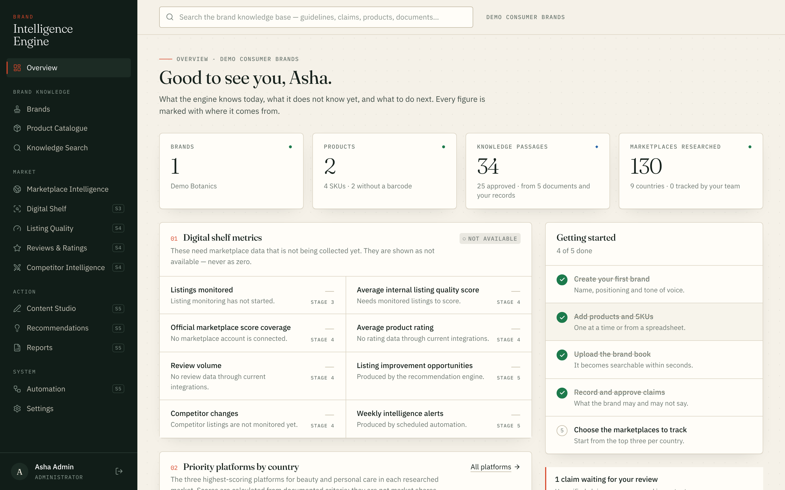 |
| **Brands** | Profile, positioning and tone of voice; guidelines from draft to approved; claims from unverified to approved or restricted, per market; competitor brands | 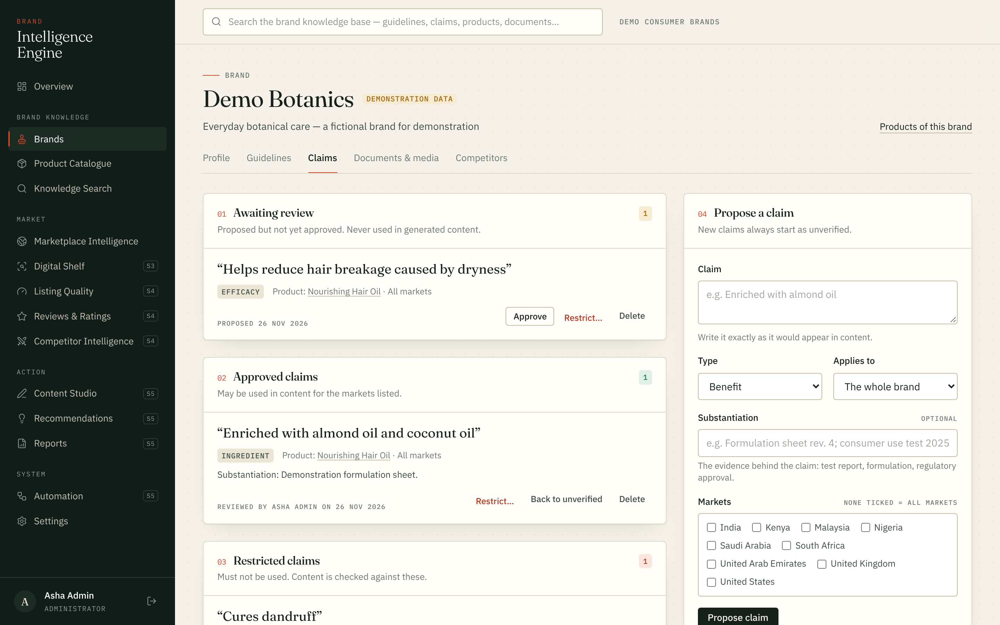 |
| **Documents & media** | Upload PDF, Word, PowerPoint, Excel, text, images and video. Documents are read in the background and become searchable within seconds, labelled unverified until approved as a source. The real file type is checked | 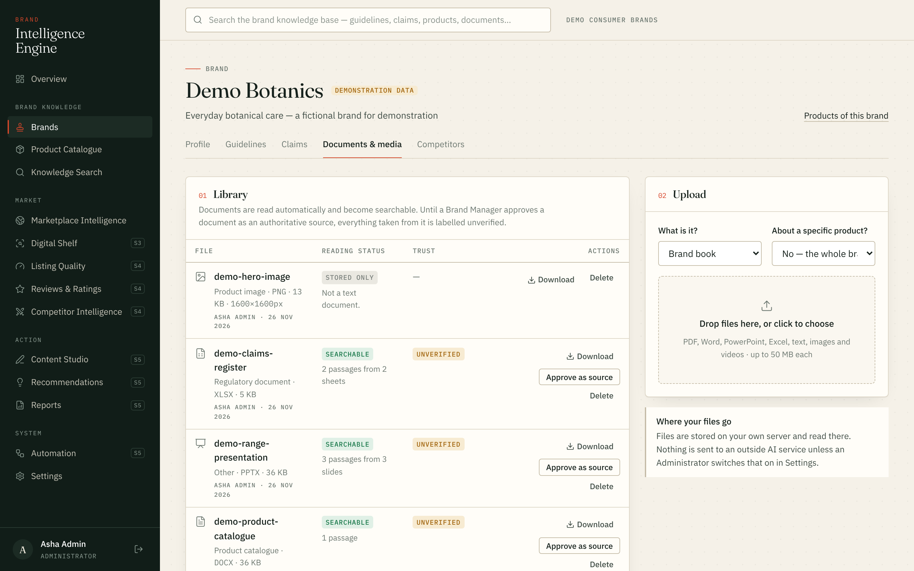 |
| **Knowledge Search** | Questions in your own words, English or Arabic. Every result shows its source, page and trust label | 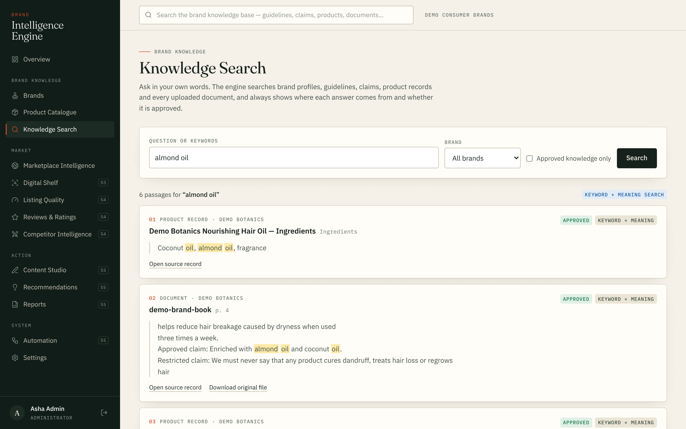 |
| **Product Catalogue** | Products, variants, SKUs and multipacks; barcode check-digit validation; marketplace identifiers; attributes; markets; spreadsheet import with a check-first step | 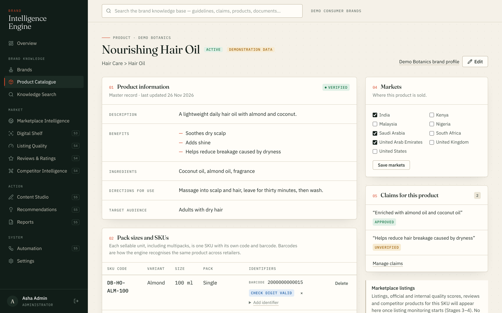 |
| **Marketplace Intelligence** | 130 platforms in nine countries with evidence, sources, confidence, data-access routes and a reproducible rank; filters; your tracking decisions and who sells each brand there | 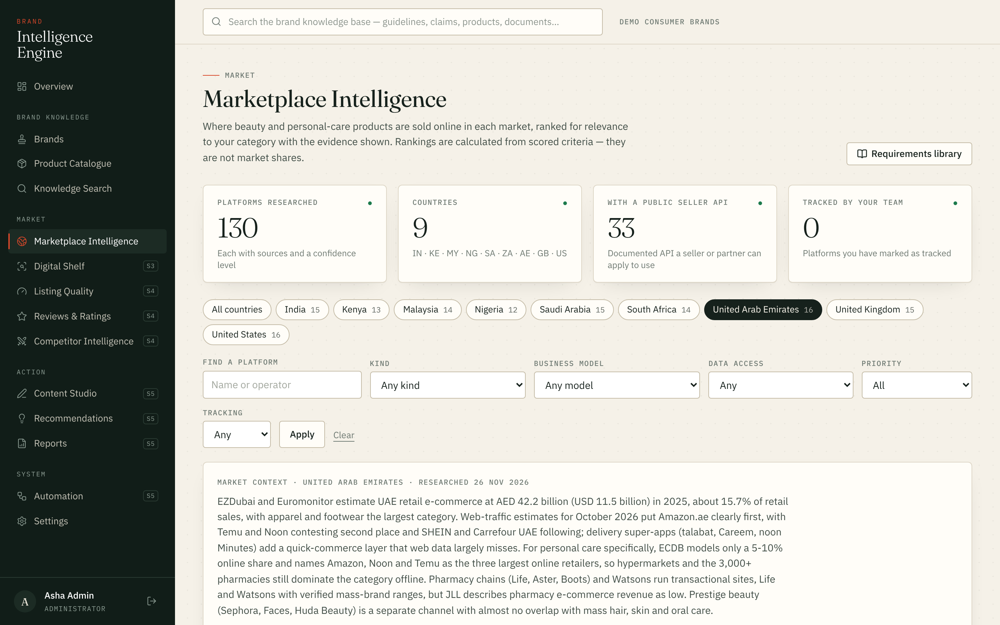 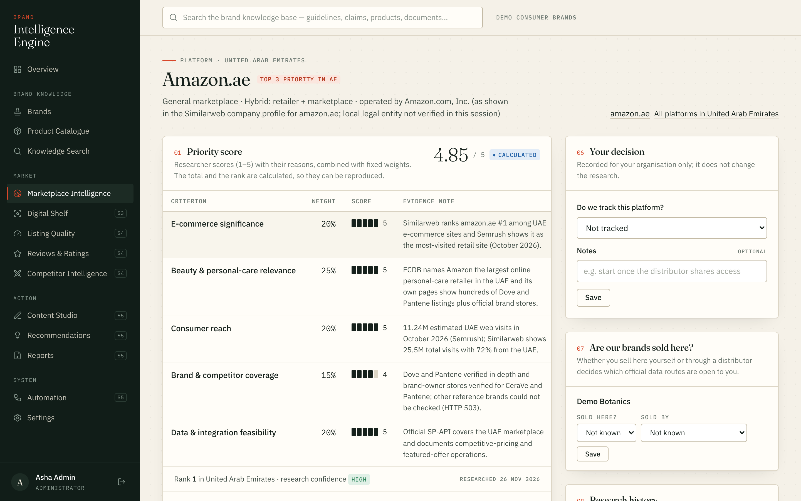 |
| **Brand Books** | Brand books and launch books built from fonts, colours, key messages, approved claims, packshots and products; approved by a Brand Manager; printed or saved as PDF | 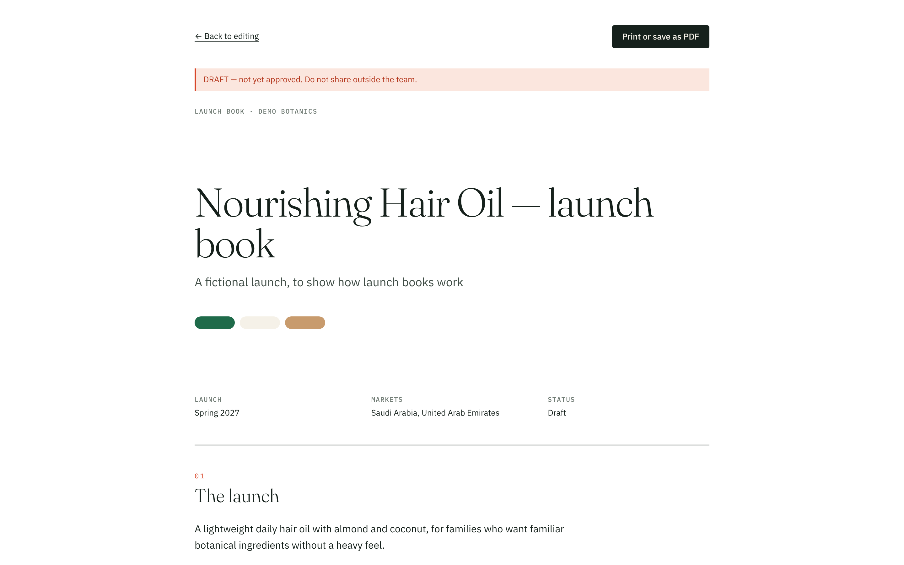 |
| **Pricing Intelligence** | Our SKUs and competitor products tracked per marketplace; prices recorded with date and source; price per 100 ml / 100 g; like-for-like price index | 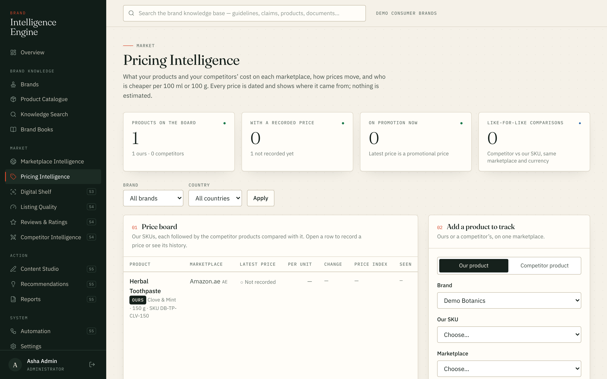 |
| **Requirements library** | 21 retailers, 668 rules, each with its official source, plus the official quality signals each retailer really publishes | 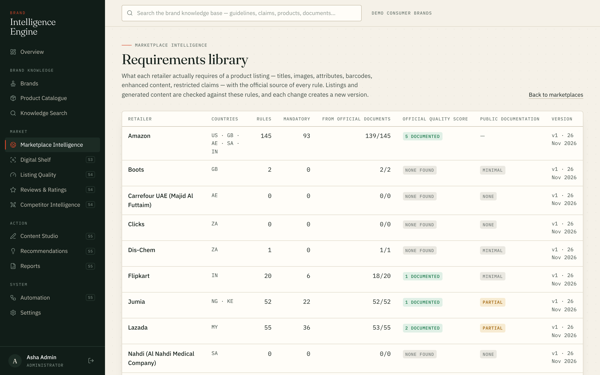 |
| **Planned modules** | Digital Shelf, Listing Quality, Reviews & Ratings, Competitor Intelligence, Content Studio, Recommendations, Reports and Automation each explain what they will do, what already exists underneath and what they need from you | 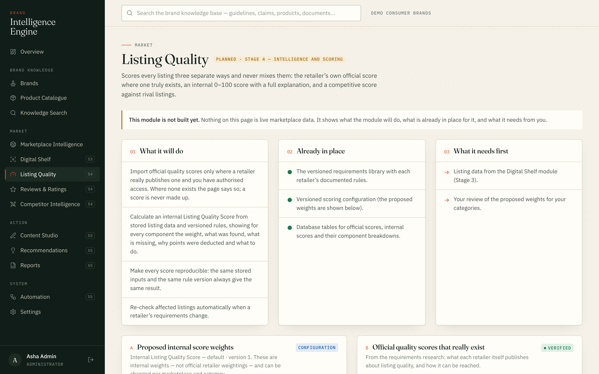 |
| **Settings** | Organisation settings and the external-AI switch (off); team and invitations; roles and permissions matrix; audit log; your account and password | 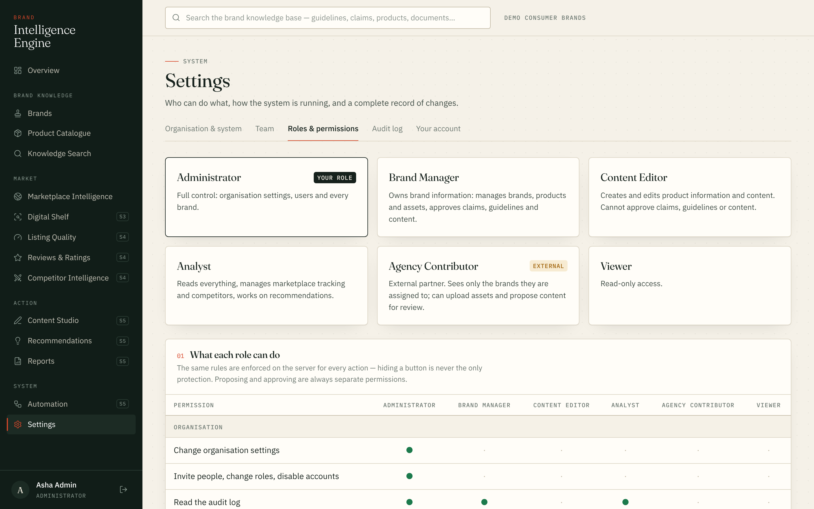 |

## 3. Progress against the MVP acceptance criteria

| # | Criterion | Status |
|:-:|---|---|
| 1 | Create a brand | ✅ Done |
| 2 | Upload a brand book | ✅ Done |
| 3 | Add products and SKUs | ✅ Done |
| 4 | Store product information | ✅ Done |
| 5 | Map marketplaces by country | ✅ Done |
| 6 | Add competitor products | ✅ Done (competitor products tracked in Pricing Intelligence) |
| 7 | Collect or import real listing data | ◐ Prices recorded by hand today; listing content and connectors in Stage 3 |
| 8 | Store historical snapshots | ○ Stage 3 (research and requirement history already kept) |
| 9 | Audit titles and descriptions | ○ Stage 4 (the rules to audit against are built) |
| 10 | Assess images | ◐ Images verified and measured on upload; rule-based assessment in Stage 4 |
| 11 | Internal listing quality score | ○ Stage 4 (weights stored as rule version 1) |
| 12 | Import official scores where available | ○ Stage 4 (which ones exist is researched and shown) |
| 13 | Analyse ratings and reviews | ○ Stage 4 |
| 14 | Content recommendations | ○ Stage 5 |
| 15 | Marketplace-specific content | ○ Stage 5 |
| 16 | Track approval status | ◐ Claims, guidelines and source documents done; content approval in Stage 5 |
| 17 | Weekly intelligence report | ○ Stage 5 |
| 18 | Explain the source of every metric | ✅ Done |

Seven done, three partly done, eight to come. The order and effort for the rest are in the [roadmap](09-roadmap.md).

## 4. How it was tested

All four checks must pass before anything is described as working. On 26 November 2026 they all passed:

| Check | Result |
|---|---|
| Type-check (`npm run typecheck`) | No errors |
| Lint (`npm run lint`) | No errors |
| Unit and integration tests (`npm test`) | **109 passed** — 29 unit, 80 integration |
| Browser tests on a production build (`npm run test:e2e`) | **23 passed** |
| Integration tests on real PostgreSQL 16 with pgvector 0.6.0 | **80 passed** |

**The browser tests follow one complete journey**, as a new team would: first-run setup (with a weak password refused), creating a brand, approving guidelines, approving and restricting claims, adding products with validated barcodes, a spreadsheet import with bad rows reported, uploading a real PDF, Word, PowerPoint and Excel file and finding their contents by search, refusing a disguised file, the marketplace map and requirements, the *not available* metrics, the audit log, inviting a Viewer, confirming that the Viewer is refused changes **on the server as well as in the interface**, refusing requests from another website, recovering a forgotten password, and signing out. The last test fails if any page crashed or the server returned an error at any point.

**Test data.** All test and demonstration content is the fictional brand "Demo Botanics", flagged *Demonstration data* wherever it appears. The test documents are real files generated for the purpose, including Arabic text. **No marketplace metric of any kind was created** — not for tests, not for the demonstration.

## 5. How to try it

On your own computer, in three commands — see the [setup guide](../guides/setup.md):

```bash
npm install
```

```bash
npm run dev
```

Open <http://localhost:3000>, create your organisation, then stop the app and run `npm run db:seed:demo` to add the demonstration brand.

To put it online for your team, see the [deployment guide](../guides/deployment.md).

## 6. What it does not do yet

| Not yet | Arrives in |
|---|---|
| Any connection to a marketplace API or data provider; any listing, price, rating or review data | Stage 3–4 |
| Listing snapshots, change detection, SKU-to-listing matching | Stage 3 |
| Listing audits, image assessment, internal and official scores, review analysis, competitor tracking | Stage 4 |
| AI content generation, recommendations, the weekly report, alerts, scheduled collection | Stage 5 |
| Single sign-on, two-step verification, database-level row security, cloud file storage, malware scanning | Stage 6 |
| Reading scanned documents (text recognition) | Stage 4 |
| Deployment to a hosting provider — it has been run as a production build locally only | When you choose a host |

The full list of known limitations is in the [architecture document, section 13](../architecture/07-system-architecture.md#13-known-limitations-of-build-1).

## 7. What was decided during the build, and why

| Decision | Reason |
|---|---|
| One TypeScript application rather than a separate Python back end | One program to run and maintain, and one set of types from database to screen. A Python worker can be added at a defined seam if heavy data science appears |
| PostgreSQL for everything, including search and the job queue | One system to back up and secure; search results respect the same access rules as everything else |
| A built-in PostgreSQL for development | The product runs with nothing to install, and behaves the same as production |
| Meaning-based search with an open model on your own server | Brand documents never leave your server, and search costs nothing per use |
| All 65 tables of Phase 1 created now | Later stages plug in without restructuring the database |
| No AI provider connected | The specification forbids sending brand documents outside without approval; that is your decision |
| Password recovery by Administrator link rather than email | No email service is needed yet, and the sign-in page does not reveal which email addresses have accounts |

## 8. What you need to decide next

1. Which marketplaces to track first, and who sells your products on each.
2. The data-collection policy for competitor data, with legal counsel.
3. Where to host.
4. Whether to approve an outside AI provider, and which.
5. Whether the proposed listing-quality weights and review themes suit your categories.

Each is explained in the [roadmap](09-roadmap.md#decisions-needed-from-you).
